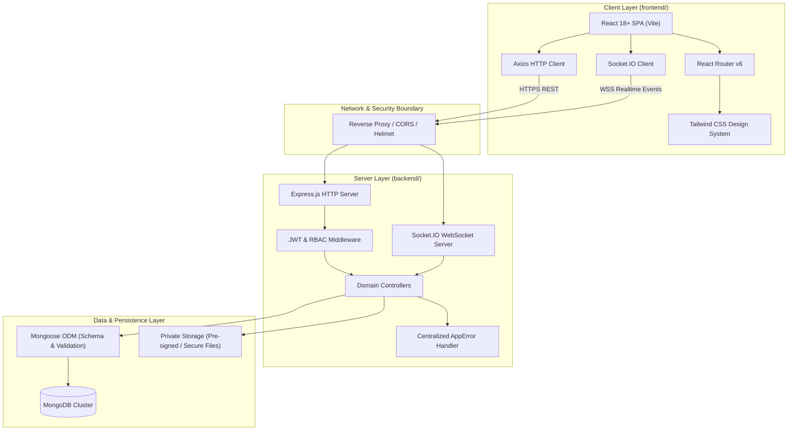

# System Architecture

## 1. High-Level Architecture Overview

The Smart Internship Management System follows a decoupled client-server architecture organized as a cohesive monorepo:

---

## 2. Frontend Architecture (`frontend/`)

### A. Technology Stack
* **Bundler & Tooling:** Vite for near-instant Hot Module Replacement (HMR) and optimized Rollup tree-shaken builds.
* **UI Framework:** React (Function components with modern Hooks and Context API).
* **Styling Engine:** Tailwind CSS with utility-first layout tokens, responsive breakpoints, and dark-mode readiness.
* **Routing:** `react-router-dom` structured with:
  * Public routes (Landing, Role Overview, Documentation links).
  * Protected role routes (Student Dashboard, Company Portal, Mentor Hub, Admin Console).
  * Fallback `NotFoundPage` (404) catching unhandled URI paths.
* **State & Networking:**
  * Axios instance with preconfigured interceptors (attaching `Bearer` auth headers, handling 401 token expiration, unified error normalization).
  * Dedicated service layer abstraction (`/src/services/`) isolating API contracts from visual presentation components.

---

## 3. Backend Architecture (`backend/`)

### A. Technology Stack
* **Runtime:** Node.js (v20+ LTS).
* **Framework:** Express.js configured with security middleware (`helmet`, strict `cors`, `express.json`).
* **Object Data Modeling (ODM):** Mongoose providing schema enforcement, type validation, virtuals, and compound index management.
* **Real-time Protocol:** Socket.IO attached directly to the native HTTP server instance for persistent bidirectional state synchronization.

### B. Core Architectural Layers
1. **Application Entry (`server.js`):** Boots the HTTP server, initializes Socket.IO listeners, connects to MongoDB, and handles OS termination signals (`SIGINT`, `SIGTERM`) for zero-downtime graceful shutdown.
2. **Express Configuration (`src/app.js`):** Mounts security headers, cross-origin rules, request loggers, API routers, and registers the global fallback 404 handler and error handling middleware.
3. **Route & Controller Layer (`src/routes/`, `src/controllers/`):** Decoupled request processing. Controllers sanitize payloads, call domain logic, and delegate response formatting to utilities.
4. **Centralized Error Handling:**
   * All asynchronous controller functions are wrapped in an async error handler or leverage native Express 5 / Promise handling.
   * Custom `AppError` class encapsulates HTTP status code, operational flags, and error messages.
   * `errorHandler` middleware standardizes output into a predictable `{ success: false, error: { message, code } }` envelope, masking stack traces in production.

---

## 4. Real-Time Architecture & Event Fabric
* **Connection Lifecycle:** Clients establish a WebSocket handshake passing JWT tokens in socket auth payloads.
* **Rooms & Channels:**
  * `user:<userId>`: Private channel for individual notifications and direct alerts.
  * `application:<applicationId>`: Channel for real-time interview scheduling, notes, and status changes.
  * `internship:<internshipId>`: Channel for cohort-wide mentor announcements.
* **Events:**
  * `notification:received`: Dispatches instant alerts for application updates or feedback.
  * `task:status_changed`: Broadcasts task state transitions to assigned mentors and students.

---

## 5. Security & Isolation Boundaries
1. **Credential Hygiene:** Zero hardcoded secrets; validated via `src/config/env.js` on boot.
2. **Private File Storage:** Resume files and evaluation artifacts are strictly excluded from public web-accessible directories. Access is gated through signed URLs or authenticated stream endpoints.
3. **Input Sanitization & Injection Defense:** No direct MongoDB querying without Mongoose schema type coercion; incoming strings are trimmed and validated.
