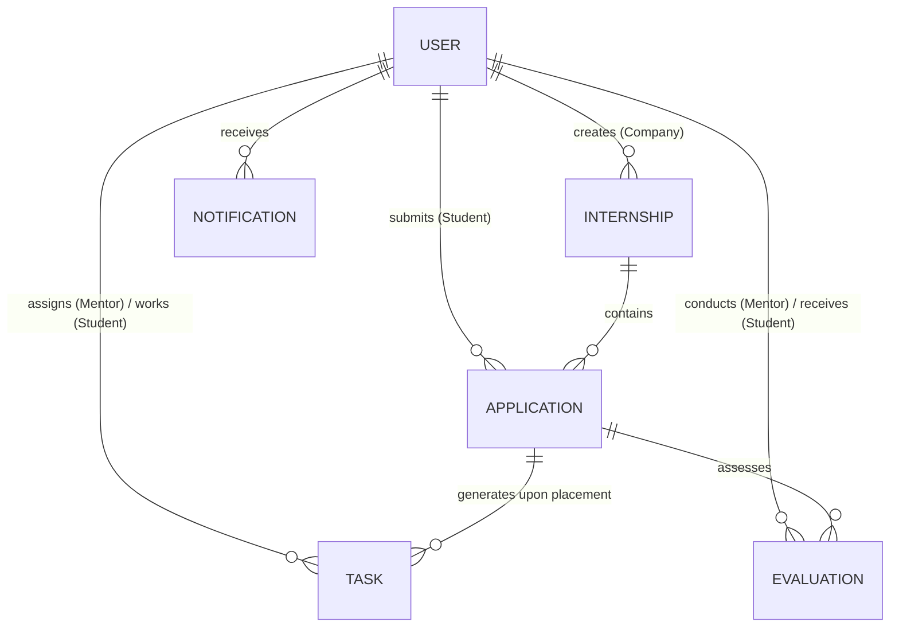

# Database Design & Schemas

## 1. Overview
The Smart Internship Management System utilizes **MongoDB** via **Mongoose ODM**. The data model balances normalized entity references (using `ObjectId` refs with `.populate()` when necessary) with selective denormalization for read-heavy operations (e.g. caching company names and student names inside applications to prevent N+1 lookups).



---

## 2. Core Collections & Schema Specifications

### A. `users` Collection
Stores credentials, core demographic data, and role-specific profile subdocuments.

```javascript
{
  _id: ObjectId,
  email: { type: String, required: true, unique: true, lowercase: true, trim: true },
  passwordHash: { type: String, required: true, select: false },
  role: { 
    type: String, 
    required: true, 
    enum: ["student", "company", "mentor", "admin"] 
  },
  status: { 
    type: String, 
    enum: ["active", "pending_verification", "suspended"], 
    default: "active" 
  },
  profile: {
    fullName: { type: String, required: true },
    avatarUrl: String,
    phone: String,
    
    // Role-specific fields
    studentDetails: {
      university: String,
      degree: String,
      graduationYear: Number,
      cgpa: Number,
      skills: [String],
      resumeFileId: ObjectId // Reference to private secure storage, never public
    },
    companyDetails: {
      companyName: String,
      industry: String,
      website: String,
      isVerified: { type: Boolean, default: false }
    },
    mentorDetails: {
      organization: String,
      designation: String,
      specialization: [String]
    }
  },
  createdAt: Date,
  updatedAt: Date
}
```

### B. `internships` Collection
Defines available internship positions posted by companies.

```javascript
{
  _id: ObjectId,
  companyId: { type: ObjectId, ref: "User", required: true, index: true },
  title: { type: String, required: true, trim: true },
  description: { type: String, required: true },
  department: String,
  locationType: { type: String, enum: ["remote", "on_site", "hybrid"], required: true },
  locationCity: String,
  stipend: {
    currency: { type: String, default: "INR" },
    amount: Number,
    isUnpaid: { type: Boolean, default: false }
  },
  durationWeeks: { type: Number, required: true },
  requirements: [String],
  slotsAvailable: { type: Number, default: 1 },
  applicationDeadline: { type: Date, required: true },
  status: { 
    type: String, 
    enum: ["draft", "published", "closed", "archived"], 
    default: "draft",
    index: true 
  },
  createdAt: Date,
  updatedAt: Date
}
```

### C. `applications` Collection
Captures student submissions for posted internships.

```javascript
{
  _id: ObjectId,
  internshipId: { type: ObjectId, ref: "Internship", required: true, index: true },
  studentId: { type: ObjectId, ref: "User", required: true, index: true },
  companyId: { type: ObjectId, ref: "User", required: true },
  assignedMentorId: { type: ObjectId, ref: "User" },
  status: {
    type: String,
    enum: [
      "submitted",
      "under_review",
      "shortlisted",
      "interview_scheduled",
      "offered",
      "accepted",
      "rejected",
      "withdrawn"
    ],
    default: "submitted",
    index: true
  },
  coverLetter: String,
  resumeSnapshotUrl: String, // Secure private access path
  interviewNotes: [
    {
      scheduledAt: Date,
      mode: String,
      feedback: String,
      conductedBy: { type: ObjectId, ref: "User" }
    }
  ],
  createdAt: Date,
  updatedAt: Date
}
```
*Index Constraint:* Unique compound index on `{ internshipId: 1, studentId: 1 }` prevents duplicate submissions.

### D. `tasks` Collection
Governs milestone deliverables assigned to accepted interns.

```javascript
{
  _id: ObjectId,
  applicationId: { type: ObjectId, ref: "Application", required: true, index: true },
  studentId: { type: ObjectId, ref: "User", required: true, index: true },
  mentorId: { type: ObjectId, ref: "User", required: true, index: true },
  title: { type: String, required: true },
  description: String,
  dueDate: { type: Date, required: true },
  priority: { type: String, enum: ["low", "medium", "high", "urgent"], default: "medium" },
  status: {
    type: String,
    enum: ["pending", "in_progress", "submitted", "revision_requested", "completed"],
    default: "pending",
    index: true
  },
  submissions: [
    {
      submittedAt: Date,
      notes: String,
      deliverableLinks: [String],
      mentorFeedback: String,
      approvedAt: Date
    }
  ],
  createdAt: Date,
  updatedAt: Date
}
```

### E. `evaluations` Collection
Stores periodic performance assessments (e.g. Midterm, Final).

```javascript
{
  _id: ObjectId,
  applicationId: { type: ObjectId, ref: "Application", required: true, unique: true },
  studentId: { type: ObjectId, ref: "User", required: true },
  mentorId: { type: ObjectId, ref: "User", required: true },
  evaluationType: { type: String, enum: ["midterm", "final"], required: true },
  metrics: {
    technicalProficiency: { type: Number, min: 1, max: 5, required: true },
    punctualityAndDeadlines: { type: Number, min: 1, max: 5, required: true },
    communicationSkills: { type: Number, min: 1, max: 5, required: true },
    initiativeAndProblemSolving: { type: Number, min: 1, max: 5, required: true }
  },
  overallScore: Number, // Computed
  qualitativeRemarks: String,
  recommendationForOffer: Boolean,
  submittedAt: { type: Date, default: Date.now }
}
```

### F. `notifications` Collection
Provides persistent storage for in-app alert bells.

```javascript
{
  _id: ObjectId,
  recipientId: { type: ObjectId, ref: "User", required: true, index: true },
  senderId: { type: ObjectId, ref: "User" },
  type: { 
    type: String, 
    enum: ["application_update", "task_assigned", "task_feedback", "system_announcement"],
    required: true 
  },
  title: { type: String, required: true },
  message: { type: String, required: true },
  link: String,
  isRead: { type: Boolean, default: false, index: true },
  createdAt: { type: Date, default: Date.now, expires: "90d" } // Automatic TTL expiration after 90 days
}
```

---

## 3. Indexing & Query Optimization Strategy
1. **Application Deduplication:** Compound unique index `applicationSchema.index({ internshipId: 1, studentId: 1 }, { unique: true })`.
2. **Directory Search:** Compound text index on `internships`: `internshipSchema.index({ title: "text", description: "text", requirements: "text" })`.
3. **Dashboard Lookups:** Compound indexes for mentor tasks: `taskSchema.index({ mentorId: 1, status: 1 })`.
4. **Notification TTL:** Self-pruning old alerts using `{ expires: "90d" }` on `notifications.createdAt`.
